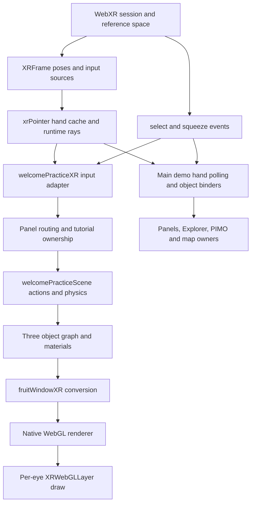

# NourishlandXR: WebXR audit and improvement plan

Audit date: 14 October 2026. Primary target: standalone Meta Quest 3 in Quest Browser. Status: **audit only; implementation and headset validation pending**.

## 1. Recommendation and evidence boundary

**Improve the existing architecture first, then compare a small, isolated Meta IWSDK implementation against it. Do not migrate the application wholesale on the evidence available.** The current application already has useful tracking caches, pinch hysteresis, native XR event handling, grab offsets, near interaction and hand rendering. Several specific application defects are reproducible without replacing those systems. The main risks are fragmented input ownership, inconsistent tracking recovery, a partial Three.js-to-native-renderer bridge, and resource preparation that can still perform substantial work during XR frames.

IWSDK is Meta's official **Immersive Web SDK**. It provides reusable components and systems for browser XR, broadly analogous in purpose to building blocks. It is a separate web framework, not Unity Building Blocks or a way to import Unity's Interaction SDK into this application. Meta describes a Three.js/ECS runtime with input, grabbing, physics, UI and development tools. [Meta IWSDK overview](https://developers.meta.com/vr/documentation/iwsdk/guides/overview/)

“Both versions side by side” should mean two selectable test routes with the same content and tasks, run **sequentially on the same headset**. It should not mean two renderers or two competing interaction systems in one immersive session. The comparison is proposed here; neither an IWSDK prototype nor a production migration was implemented during this audit.

### Scope and snapshot

- Inspected the actual working checkout at `C:/FILES/Projects/website/github/NourishlandXR`, including uncommitted tutorial work. HEAD during inspection: `1e0ab707a67c42070da3402a08f6b5d6a63a565c`.
- This is an actively changing checkout. The first retained inventory records version `0.9597`; the refreshed inventory at `2026-10-14T04:54:09Z` records `0.9599`. Other work changed files during inspection. These are source snapshots, not an assertion about the deployed release. SHA-256 hashes and line counts are in the evidence files below. Recheck references before implementation if the checkout changes again.
- At final verification the build version was `0.9601`; `buildInfo.js`, `welcomePracticeScene.js` and `welcomeVisitorIntroduction.js` had changed again relative to the refreshed inventory. The focused tests and boundary probes were rerun successfully. References describe the inspected paths; ongoing edits can move line numbers. This audit did not create those production changes.
- **No production source, assets, dependencies, version or release settings were changed by this audit.** Only this report and audit evidence scripts/results were created. No production build, commit, deployment or Quest acceptance is claimed. The release/version rule applies when approved production edits are implemented; a documentation audit must not alter the running experience.
- Existing focused Node tests passed: **80 passed, 0 failed**. These use unit, mock and source-contract checks; they do not establish headset usability or GPU performance.
- No physical Quest session, GPU capture, motion-to-photon measurement, browser heap recording or thermal run was available. User-reported frame drops and interaction difficulty remain important reports, but their magnitude and exact rendering cause have not been measured here.

Evidence files:

| File | What it establishes |
| --- | --- |
| `artifacts/xr-audit/source-and-asset-snapshot-initial.json` | Initial source hashes, version and stored GLB geometry inventory. |
| `artifacts/xr-audit/source-and-asset-snapshot.json` | Refreshed inventory of the moving checkout. |
| `artifacts/xr-audit/texture-snapshot.json` | Embedded-image dimensions and RGBA8-equivalent sizes; not measured residency. |
| `artifacts/xr-audit/probes.mjs` | Read-only imports and mock/VM boundary probes against production functions. |
| `artifacts/xr-audit/probe-results.json` | Reproductions for hand edges, pose recovery, panel ownership expiry, texture limits and emissive support. |
| `artifacts/xr-audit/focused-tests-final.log` | Final focused test run: 80 passed, 0 failed, after refreshing the source review. |

Classification used throughout:

- **CONFIRMED ISSUE:** a code path or isolated reproduction demonstrates the stated defect. This does not imply its frequency on Quest has been measured.
- **LIKELY ISSUE:** source evidence supports a plausible user-facing problem, but device reproduction or timing attribution remains necessary.
- **EXPERIMENTAL IDEA:** a candidate architecture or optimization requiring comparison, not a promised improvement.

## 2. Actual architecture map

The main immersive demo is **not rendered by Three.js WebGLRenderer**. It uses Three.js objects, loaders and math, then custom native WebGL renderers inside a manually managed WebXR session. Other routes do use WebGLRenderer. That distinction determines framework compatibility and explains why a desktop material can behave differently in XR.

| Area | Actual files and entry points | Responsibility |
| --- | --- | --- |
| Delivery and dependencies | `package.json`; `tools/build-hosted.mjs`; `docs/ARCHITECTURE.md:7` | Native ES modules and hosted-tree build. No installed IWSDK, React, A-Frame or interaction framework in the root dependency manifest. |
| Three.js | `app/vendor/three.module.min.js`; `app/vendor/three.core.min.js`; `app/assets/fruit-window/vendor/three.module.js:2` | Actual imported revision is **r180**. The fruit-window module reexports the shared vendor module; similarly named files do not by themselves prove duplicate active Three instances. |
| Session policy | `app/services/webxrSession.js:64`, `:98`, `:114` | AR preference, VR fallback, optional hand tracking, hit-test/DOM-overlay fallbacks, refresh-rate configuration. |
| Main immersive entry | `app/screens/temporaryArDemo.js:6611` | Creates WebGL1 context, XRWebGLLayer, local-floor/local reference space and optional viewer hit test. |
| Main frame loop | `app/screens/temporaryArDemo.js:6803`, `:6834`, `:6860`, `:6887` | XR RAF, viewer pose, input and application updates, then per-eye native drawing. |
| Shared tracking | `app/services/xrPointer.js:54`, `:62`, `:144` | Per-source hand cache, joint samples, filtering, pinch state/sequence, runtime aim ray and controller ray conversion. |
| Hand visuals | `app/services/xrHandOutline.js:6`, `:45`, `:56` | Bundled left/right hand rigs, raw-joint GPU skinning, separate controller-driven virtual hands and their pointing direction. |
| Tutorial XR adapter | `app/services/welcomePracticeXR.js:12`, `:20`, `:41`, `:57` | Session events, polled controller/hand input, panel routing, tutorial update and native renderer replacement. |
| Tutorial application | `app/services/welcomePracticeScene.js:58`, `:146`, `:171`, `:249`, `:310` | Lesson state, readiness/narration gating, direct grabbing, two-hand fruit actions, body updates and scene revisions. |
| Orb and physics | `app/services/welcomeControlOrb.js:38`; `app/services/welcomePracticePhysics.js:22` | Orb learning actions and gravity toy; custom bounded/substepped physics. |
| Native scene bridge | `app/services/fruitWindowXR.js:11`, `:45`, `:54` | Converts Three scene data, geometry and morphs to the custom renderer; progressive preparation and quantized morph updates. |
| General native renderer | `app/services/demoLivingMapXR.js:44`, `:76`, `:111`, `:148`, `:169` | Buffers, textures, instancing/fallback batching, portable lighting shader and GL draw calls. |
| Performance policy | `app/services/xrPerformanceSettings.js`; `app/services/welcomePracticeXR.js:66` | Quality/recovery policy, callback cadence and instrumented JavaScript timing. These are not whole-application GPU measurements. |
| Living Frame | `app/services/livingFrameModel.js:43`, `:47`; `app/services/livingFrameXR.js:47` | Cached model/growth/hit testing; separate native renderer with indexed geometry. |
| Zinnia in main scene | `app/services/zinniaFramePerch.js:24`, `:55`, `:61`; `app/services/welcomeZinniaGuide.js` | Model/native bridge, animation, pose/follow behaviour; an existing guard avoids updating once per eye. |
| General interaction routing | `app/screens/temporaryArDemo.js:5119`, `:5157`, `:5242`; `app/services/welcomeInputRouting.js:3` | Source selection, event-frame controller rays, hand polling, event suppression and tutorial/panel arbitration. |
| Panel touch and pinch | `app/services/pimInfoPanel.js:1322`, `:1646`, `:1672`; `app/services/handPoke.js:16`; `app/services/handSurfaceInteraction.js:14` | Near hover/poke, dwell/retreat thresholds, pinch deduplication, sliders and spatial panel movement. |
| Living map / Explorer / PIMO | `app/services/demoLivingMapGrip.js:23`, `:75`; `app/services/explorerMoleculeInteraction.js:14`, `:27`, `:45`; `app/services/pimActivationHold.js:37` | Independent ownership, grab, hold and activation implementations. |
| Fruit Window | `app/services/fruitWindowExperience.js:286` | Another fruit interaction path, separate from tutorial grabbing. |
| Planting / watering / flight | `app/services/welcomePlantPractice.js:68`; `app/services/welcomeWaterStream.js`; `app/services/welcomeFlightLesson.js:10` | Gameplay-specific spatial tests and movement. Optional flight currently uses a dragonfly model; do not infer a separate firefly implementation from the lesson name. |
| Painting / haptics | `app/services/tutorialMagicBrush.js`; `app/services/spatialPaintV2.js`; `app/services/demoFeedback.js:21`, `:34` | Stroke operations, controller tools, capability-dependent haptics and continuous-feedback watchdog. |
| Creator spatial XR | `app/screens/arMode.js:6315`, `:6434` | Another native WebGL1 session/loop, shared session helper and panel modules. |
| Other Three renderer routes | `app/screens/spatialPaintStudio.js:40`; `app/screens/livingPaintingTest.js:60`, `:147` | Three WebGLRenderer/XR lifecycle rather than the main demo's native path. |
| Physical placement | `app/services/physicalAnchor.js`; `app/screens/physicalAnchorScanner.js:13`; `app/services/spatialDeviceAdapters.js:7` | Marker/adapter abstractions. No active persistent WebXR anchor creation/restoration found. |



### Input-to-action trace

1. **Controller tutorial:** XR select/squeeze event enters `welcomePracticeXR.bind`. Panel routing may yield it; otherwise the listener captures it, records forced button state and invokes selection. Each XR frame also polls gamepad levels and samples grip/target-ray poses. The scene uses these to acquire, attach, release, open fruit or perform a lesson action. These are two input delivery channels, intentionally bridged but not governed by one application-wide action owner.
2. **Tracked-hand tutorial:** shared `handTrackingState` samples joints once per source/frame. The adapter derives palm pose and a pinch-or-fist grab level, plus a separate pinch trigger. The scene performs proximity acquisition and offset-preserving attachment. The hand renderer separately consumes raw joints. Controller-driven virtual hands are a different mode and use synthesized joints/aim.
3. **Main demo:** `updateDemoControllerRay` gathers sources and selects an active hand/ray; separate pollers and session listeners manage plants, map handles, panels, butterflies, notes and knowledge objects. Some use per-source state; the final main-demo pinch edge still uses one global Boolean. Listener ordering, capture and suppression deadlines provide arbitration.
4. **Render:** application changes Three transforms/materials/morphs; the native bridge uploads/transforms its supported subset; the native renderer draws each eye. This is not the complete Three material/rendering pipeline. Updating a Three property is insufficient unless the bridge/shader supports it.

## 3. Existing strengths to preserve

- Joint caching and `beginHandTrackingFrame` avoid blindly resampling every consumer. Pinch already has **25 mm enter / 38 mm exit hysteresis** in `xrPointer.js:96`; replacing it with a single threshold would regress behaviour. A browser-provided pinch button takes precedence where available.
- Runtime `targetRaySpace` is preferred for hand aim. A raw finger direction is a fallback, not the only hand ray. Generic controller rays use runtime -Z aim.
- Tutorial attachment retains the initial object-to-hand offset. Throwing uses recent motion samples with bounded velocity, rather than snapping every object to a fixed wrist position.
- Native rendering already includes instancing when available, CPU fallback batching, geometry sharing, quantized tutorial morph updates and progressive preparation. Living Frame growth and raycast caching are already throttled/cached. Zinnia's main-scene update already avoids duplicate eye updates.
- Panel code has source-specific state, pinch-sequence deduplication, direct-touch suppression of far activation, poke dwell/retreat checks and loss-of-visibility cleanup. These are useful foundations, not systems to discard indiscriminately.
- Tutorial narration now checks asset/readiness/reveal conditions and renderer revision before speaking (`welcomePracticeScene.js:319` onward). This is a real safeguard. Verify the last rendered/presented frame on device rather than assuming the earlier “speaks before spawn” report remains unchanged.
- Session startup has capability/fallback handling and a bounded refresh-rate request. Bare hands do not have controller haptics; visual feedback must remain sufficient.

## 4. CONFIRMED ISSUES

Priorities express proposed order, not measured incident frequency. P1 means address before claiming interaction reliability; P2 means important correctness or maintainability work.

### C1 — Orb light/pulse does not reach the native shader — P1

**Evidence:** `welcomeControlOrb.js:38-42` implements part of the learned light behaviour through `emissive`/`emissiveIntensity`. `demoLivingMapXR.js:123` and its shader at `:169` have no emissive input. The probe executes the real native renderer with mocked GL: changing emissive/intensity changes no relevant uploaded float uniforms and no emissive uniform exists. Base-colour changes can still work, so this is specifically the light/pulse channel.

**Consequence:** the desktop scene can show an Orb effect that the actual immersive renderer cannot reproduce. A lesson can wait for an action while its intended feedback is missing.

**Action:** add a narrowly scoped, default-zero emissive contribution to the native material bridge/shader, or implement the Orb effect through an explicitly supported native property. Test off/on/pulse and stereo appearance without changing all materials' brightness. Do not introduce bloom to fix this.

### C2 — Tracking recovery can be treated as a new gesture — P1

**Evidence:** `xrPointer.js:97-109` clears pinch when required joints disappear; restoring a still-closed hand increments `pinchSequence` again. The probe reproduces sequence 1 → loss → sequence 2 without opening. Independently, `demoLivingMapGrip.js:75-82` releases on invalid pose and begins again whenever a valid pressed sample returns. The actual module probe records two grabs across one uninterrupted physical press.

**Consequence:** accidental recapture or repeated activation after tracking loss is possible. Each consumer's edge handling determines the resulting action; this is not evidence that every consumer double-activates.

**Action:** introduce an explicit lost/rearming state per source. After invalid tracking, require a neutral/released sample before a fresh discrete activation. Preserve the intentionally supported behaviour of holding grip and moving into fruit contact **during uninterrupted valid tracking**. Treat restoration of a cancelled ownership differently from a fresh grab.

### C3 — Visual and interaction validity can disagree — P1

**Evidence:** `xrPointer.js:97`, `:107` can report interaction-tracked with thumb/index/wrist while visual confidence requires all joints. `xrHandOutline.js:45` refuses rendering if any required rig joint is absent. Removing only the pinky tip in the synthetic frame yields `tracked=true`, `pinch=true`, `visualConfidence=0`.

**Consequence:** the structure permits an invisible but active hand. This is a confirmed boundary inconsistency; the frequency of partial joint availability on a real Quest runtime is unmeasured. It must not be presented as a measured Quest occlusion defect.

**Action:** define separate pose-valid, aim-valid, pinch-valid and visual-valid states, then an explicit interaction policy. Either show a small reliable contact proxy when interacting or suppress new selections while the hand cannot be represented. Never keep interacting invisibly by accident. Use only a short, bounded visual grace period; do not extrapolate stale input into activation.

### C4 — Base-colour textures bypass the requested texture limit — P2

**Evidence:** `fruitWindowXR.js:45` requests `maxTextureSize:1024`. `demoLivingMapXR.js:76-85` applies size handling to detail maps, but `:111-115` uploads the base image directly. The actual renderer probe uploads a 2048×2048 base image despite the 1024 limit.

**Consequence:** the configured budget is not a reliable bound. Many current assets are already at or below 1024; this reproduction does not establish that a current 2048 texture caused the user's frame drop.

**Action:** apply the same policy to base-colour uploads, preserving aspect ratio, orientation, alpha, filtering and colour handling. Check actual GL maximum size as well. Test a deliberately oversized texture and current labels before choosing a smaller quality tier.

### C5 — Explorer controller events use a previous frame's target/attachment pose — P2

**Evidence:** `explorerMoleculeInteraction.js:14-15` reads cached matrices; select/squeeze handlers at `:27-34` ignore `event.frame`. Those matrices are refreshed only by `update` at `:45-53`. The main demo's controller-event helper (`temporaryArDemo.js:5157`) already samples the event frame, showing a compatible local pattern.

**Consequence:** a fast aim/press can select or attach relative to the preceding sampled pose. The error magnitude depends on motion and timing; no device latency number is asserted.

**Action:** use event-frame target-ray and grip poses for controller gesture starts with the current reference space, falling back only when unavailable. Leave the current hand path and ongoing attachment logic intact initially.

### C6 — A tested gesture router is not the production gesture router — P2

**Evidence:** `demoXrInteraction.js:10` exports `createDemoGestureRouter`, but no production import/use was found. Some gesture claims in `tests/demo-xr-interaction.test.mjs:26` exercise this helper. Production still uses the listeners and pollers in `temporaryArDemo.js` and individual modules.

**Consequence:** passing this helper's tests cannot establish production event arbitration. Other tests do cover real modules; this finding does not invalidate the whole suite.

**Action:** test real production listener registration/order, ownership and cancellation with a small XR session harness. Rename or remove misleading coverage claims. Do not wire the unused helper into production simply to make its tests relevant.

### C7 — Switching pinching hands can lose the new hand's edge — P1

**Evidence:** `temporaryArDemo.js:259`, `:5242-5267` uses a global `handPinchActive` alongside source-specific tracking. A VM probe executing the actual `pollDemoHandPinch` function produces zero new activations when the newly selected pinching hand inherits the previous hand's true flag; clearing the flag produces one.

**Consequence:** a legitimate pinch can appear unresponsive when active-source ownership changes. Fixing browser tracking cannot correct this application state error.

**Action:** make gesture history source-specific and retain explicit current object ownership. Test left→right and right→left hand changes, simultaneous pinches, UI ownership and held-object release. A source change must neither inherit another source's edge nor steal its object.

### C8 — Visibility-only changes can rebuild the complete tutorial renderer — P2

**Evidence:** `welcomePracticeScene.js:58` makes every `notifyAssets()` increment the structural revision. Apple model changes (`:291`), body visibility changes (`:310-311`) and other transitions call it. `welcomePracticeXR.js:57-58` then creates a complete replacement `createFruitWindowXR`, prepares it and destroys the old renderer. `fruitWindowXR.js:49`, `:78` budgets work between tasks, not inside one large conversion. `demoLivingMapXR.js:138` prepares geometry; textures can still upload on first draw.

**Consequence:** whole-scene conversion and overlapping old/new resources are confirmed work. Their contribution to Quest frame-time spikes is **LIKELY**, not measured. Some changes genuinely add meshes; not every rebuild can simply be deleted.

**Action:** distinguish structural additions/removals from transform, visibility, material, morph and texture dirtiness. Cache stable resources and update small changed sets. Instrument before refactoring; preserve renderer-revision/narration readiness semantics. Add texture preparation to the measured queue rather than declaring a scene ready after buffer preparation alone.

## 5. LIKELY ISSUES requiring focused device verification

| ID | Source evidence | Likely effect and how to resolve uncertainty |
| --- | --- | --- |
| L1: ownership expires before release | `welcomeInputRouting.js:3-10` holds a 700 ms deadline. Probe expires it at 701 ms without release. Panel ownership callback includes dragging/slider state, but ordinary button gesture ownership is not exposed by `pimInfoPanel.js:1639`. | Long button press, pointer departure or tutorial polling may cross owners. Reproduce with a >1 s panel press while a fruit is nearby. Replace deadline ownership with source+gesture capture until release/cancel; retain deadlines only as recovery safeguards. |
| L2: cancellation policies differ | Main cancellation at `temporaryArDemo.js:737`; module-specific listeners; tutorial `welcomePracticeXR.js:36-38`; Explorer `:37-38`. Some paths cancel on any non-visible state; others only on hidden. | Stale gesture/owner during system overlays, source replacement or pause. Run an ownership trace through visible-blurred, hidden, removed source, end and recenter. Use one cancellation contract and no throw on tracking cancellation. |
| L3: raw visuals and filtered interaction differ | `xrPointer.js:83-92` filters joint positions; `xrHandOutline.js:56-59` draws raw rig joints; tutorial direct inputs also deliberately read raw joints. | Inconsistent contact/ray/mesh alignment between consumers, rather than one universal smoothing problem. Record each consumed pose before adding smoothing. Keep head pose untouched and avoid extra latency on attached objects. |
| L4: scale-sensitive fist and grasp thresholds | `welcomePracticeXR.js:46-50` uses absolute wrist-to-fingertip distances, 87/105 mm; `welcomePracticeScene.js:171-175` combines palm/radius tolerances. | Different hand sizes, thumb postures and object bounds may acquire inconsistently. Compare child/small/large hands; normalize curl to measured joint-chain lengths and tune with data. Do not interpret a fist as pinch or assume virtual controller hands equal tracked hands. |
| L5: costly raycast candidates and allocations | `xrMeshPointerContact.js:6-22` traverses geometry, updates matrices and builds a cache key; single last-key caching can be displaced by alternating pointers. `welcomePracticeXR.js:63` and panel code have multiple consumers. | CPU spikes or GC, especially near dense meshes. Count casts/triangles and allocation stacks per phase. Start with per-source/per-frame result reuse and simple interaction proxies; add BVH only if measured mesh tests justify it. |
| L6: general native renderer lacks spatial/depth ordering sophistication | `demoLivingMapXR.js:44`, `:148-162` walks visible objects without a frustum test; sorting is created once rather than by transparent depth per eye; many materials draw two-sided. | Offscreen work, botanical overdraw and transparency artifacts. Measure visible/candidate draws and compare a near-Zinnia capture. Prototype bounds culling first; avoid blindly merging transparent leaves or changing winding. |
| L7: expanded geometry and dynamic copies | `fruitWindowXR.js:11-32`, `demoLivingMapXR.js:45-56` flatten indexed geometry and maintain converted/morph data; scene matrices update in bridge/native paths. | CPU/memory bandwidth and vertex work may exceed what asset byte sizes imply. Track uploaded bytes, changed attributes and per-frame matrix traversal. Preserve indexing or dirty-update attributes selectively after profiling. |
| L8: near-Zinnia frame drop | Zinnia has 113 stored primitives / 51,840 triangles; Living Frame SD adds 93 / 136,356. Morph work, resource transitions and close-up fill can overlap. | A genuine user report, but no proven single cause. Compare Zinnia visible/hidden, animation on/off, close/far, identical resolution and frame rate. Close approach points toward fill/overdraw as one hypothesis, not proof of tracking failure. |
| L9: hover and activation feel inconsistent across experiences | Fruit Window caches hover at ~100 ms in `fruitWindowExperience.js:286-338` but uses an immediate full cast for selection. Tutorial fruit uses grip/palm contact, other fruit uses its own trigger/two-hand path. | Hover may visibly lag without all clicks being delayed. Measure feedback independently from selection; define consistent affordances and modality-specific actions. Do not label 100 ms as universal XR input latency. |

## 6. Interaction quality by activity

| Activity | Actual mechanism and assessment | Proposed acceptance focus |
| --- | --- | --- |
| Hands and pinch | Shared 25-joint sampling and hysteresis exist; scalar `visualConfidence` is an application heuristic, not a platform confidence measurement. C2/C3/C7 are application-level weaknesses. | Exactly one activation per deliberate gesture, visible feedback, no fresh action after pose loss until rearmed. |
| Controllers and virtual hands | Runtime grip/aim exists; synthesized virtual hands can replace aim with index direction (`welcomePracticeXR.js:20`, `:54`). That event path can use the previous frame's virtual-hand ray. | Rendered fingertip, button ray and actual hit agree in both hands and every tool; stable attachment without adding arbitrary smoothing. |
| Orb | Direct interaction and learned actions; gravity toy uses custom physics. Emissive feedback gap C1 is definite. | All learned actions remain usable; actual XR light/pulse matches lessons; released Orb stays within intended table boundaries. |
| Fruit picking, basket and plate | Offset grab, one owner per body, basket constraints, fruit support and simplified separation. Two-hand outward opening, banana peel and apple mouth actions have distinct paths. | Compare banana and every other fruit with identical input traces, bounds and basket state. Measure misses/acquisition time. Check held-vs-basket constraints and contact-blocked state before blaming model mass. |
| Fruit physics | `welcomePracticePhysics.js:22-47` clamps dt and substeps to at most 1/120 s; approximated supports/separation, not a general rigid-body engine. | No basket penetration/overlap at typical speeds, stable resting poses, no explosive catch-up after pause. Introduce general physics only if these gameplay bounds cannot be met. |
| Planting and watering | Local seed acceptance volume, spout orientation/stream tests and custom timing; `welcomePlantPractice.js:68` onward. | Spatial hit volume matches visible pot/seed and stream. One action owner; frame drops must not make pouring intermittent or repeat planting. |
| Optional flight / firefly-like control | `welcomeFlightLesson.js:10-24` uses eased target velocity and ring crossing; optional companion currently dragonfly. | Distinguish intentional acceleration/easing from pose lag. Right/left/menu inputs must not conflict. Keep optional activities outside mandatory tutorial progression unless explicitly enabled. |
| Painting | Dedicated brush tip/tool pose, strokes, undo/erase/move operations and feedback. Continuous haptic refresh has a watchdog in `demoFeedback.js:34-40`. | Right-hand model alignment, tip/ink agreement, menu hit feedback and no simultaneous drawing/UI activation. Test haptic stop on loss, menu, pause and exit. |
| Panels and buttons | Near poke has 120 ms dwell, retreat checks and hand-shape gating (`handPoke.js:16-38`); far pointer and pinch also operate. | Stable hover on actual icon surface; generous invisible hit targets; exact single-owner click/slider/drag. Dwell applies to poke, not all input. Use compact recognized icons with accessible names and focus hints. |
| PIMO / LIMO / Explorer / totems | Independent activation and hold listeners. Current PIMO controller path activates on select-start (`pimActivationHold.js:37`); current LIMO setup can use duration 0. Explorer has its own 500 ms face hold. | Do not assume old 500/850 ms descriptions are current universal behaviour. Document each intent; test overlapping sign/panel/object targets and cancellation without changing functioning Curiosity flows. |
| Placement and comfort | local-floor/local, reset rebasing and hit tests exist; menu/pause and table placement are tutorial concerns. | Seated/standing and small reach; adjustable table outside body; recenter leaves scene stable. No invisible active hands, persistent lasers or colour-only state. Never move head/camera pose to “fix” object jitter. |

Differences from polished native XR can originate in application gesture state, attachment conventions, ownership, feedback, asset upload stalls and inconsistent target acquisition. Browser/platform scheduling and available tracking APIs also matter. **A new framework cannot repair underlying headset tracking and does not promise native Unity parity.** Diagnose tracking pose quality, application response and rendering cadence separately.

## 7. Standards and dependency compatibility

| Capability | Current implementation | Evidence-backed direction |
| --- | --- | --- |
| Hand joints and models | Custom shared sampling; bundled Meta hand rigs and raw-joint skinning. | WebXR Hand Input supplies joints; not a standard numeric confidence score. Feature-detect bulk `fillPoses`/`fillJointRadii` before a measured sampling optimization. Three's XRHandModelFactory is an alternative model loader, not a complete gesture/UI stack. [Hand Input standard](https://www.w3.org/TR/webxr-hand-input-1/), [Three hand factory](https://threejs.org/docs/pages/XRHandModelFactory.html). |
| Pinch and tracking validity | Browser button where available; 25/38 mm fallback, per-frame cache, incomplete rearming. | Keep hysteresis; add source lifecycle and validity policy. Consider scale-aware thresholds only after recordings. [Meta WebXR hands](https://developers.meta.com/vr/documentation/web/webxr-hands/). |
| Controller mapping and visuals | Quest-oriented button indices and separately loaded models. | WebXR Input Profiles can provide semantic mapping and model animation. A small engine-independent motion-controller adapter is a better first candidate than a full runtime. Preserve correct gamepad layout fallback and session-source identities. [Official motion-controllers package](https://github.com/immersive-web/webxr-input-profiles/blob/main/packages/motion-controllers/README.md). |
| Session/render management | Manually owned WebGL1 context, XRWebGLLayer and RAF in main demo/Creator. | Three WebXRManager provides hand/controller objects and renderer-owned XR integration. Three WebGLRenderer r163+ requires WebGL2. It cannot simply take over the existing WebGL1 context. An upgrade requires a separate renderer/session owner and native GL state compatibility work. [WebXRManager](https://threejs.org/docs/pages/WebXRManager.html), [WebGLRenderer requirements](https://threejs.org/docs/pages/WebGLRenderer.html). |
| Near/far UI and manipulation | Several custom ray, touch, poke and grab implementations. | Vanilla pmndrs pointer-events/handle are component candidates; they still need application ownership and transform adapters. IWSDK uses these families of components, so they deserve a focused compatibility trial. [pointer-events](https://github.com/pmndrs/xr/tree/main/packages/pointer-events), [handle](https://github.com/pmndrs/xr/tree/main/packages/handle). |
| Reference spaces and anchors | Session-local placement/rebasing and printed marker abstractions. | These are not persistent XR anchors. Quest Browser documents mixed-reality anchor APIs; request/feature-detect anchors and persistence separately, handle permission/origin/storage failures and provide session-local fallback. This is a new capability, not a repair for C7. [Meta mixed-reality APIs](https://developers.meta.com/vr/documentation/web/webxr-mixed-reality/), [official anchor sample](https://raw.githubusercontent.com/immersive-web/webxr-samples/main/anchors.html). |

### IWSDK-specific compatibility findings

The inspected upstream core package identifies version **1.0.1**, uses `three` aliased to `super-three@0.181.0`, and includes ECS, physics, interaction and UI dependencies. These are inspected upstream source values, not an installed or locked project version. Importing the entire core into this native-ESM/r180/WebGL1 path would introduce renderer, lifecycle, module-resolution and Three-instance questions. It is not a dependency-only upgrade. [Core package source](https://github.com/facebook/immersive-web-sdk/blob/main/packages/core/package.json)

The separate `@iwsdk/xr-input` package declares a Three peer range of `>=0.160.0`, making r180 a plausible version-level candidate. Its manager still expects an XR-manager-like interface for session, frame and reference-space access, scene/camera objects and ongoing updates. That peer range is **not proof of compatibility with the custom native renderer**. Its hand/controller visual adapters, object identities, pointer events and cleanup must be tested with one Three instance. [Input package metadata](https://raw.githubusercontent.com/facebook/immersive-web-sdk/main/packages/xr-input/package.json), [manager implementation](https://raw.githubusercontent.com/facebook/immersive-web-sdk/main/packages/xr-input/src/xr-input-manager.ts)

IWSDK grabbing also has configurable hand behaviour: its inspected grab-system source defaults `useHandPinchForGrab` to false. A pilot must deliberately map the intended gesture rather than assume installing the SDK makes pinch grab everything. [Grab system source](https://raw.githubusercontent.com/facebook/immersive-web-sdk/main/packages/core/src/grab/grab-system.ts)

Preserve the current content/data modules and GLB assets in any pilot. Use a bundled isolated route, pin exact dependency versions and audit licenses/assets. Do not mix vendored r180 classes with another uncontrolled Three copy or attach two competing owners to existing objects. No dependencies were installed in this pass.

## 8. Performance: evidence and measurement plan

### Asset evidence

These counts come from stored GLB primitives, not measured visible draw calls, transformed vertices per frame or stereo totals. The general native bridge expands indexed geometry; instancing, visibility and renderer batching change actual cost.

| Asset | Stored triangles | Stored primitives | Other relevant evidence |
| --- | ---: | ---: | --- |
| Living Frame SD | 136,356 | 93 | ~11.3 MiB GLB; four images, ~3.25 MiB RGBA8-equivalent before mips/copies. |
| Living Frame HD | 215,452 | 93 | ~17.3 MiB GLB; not a recommended automatic Quest upgrade. |
| Zinnia | 51,840 | 113 | ~2.07 MiB GLB, morph animation, no embedded texture images. Many material/mesh pieces are a batching candidate, not proof of 113 actual draws per eye. |
| Left/right hand, each | 2,314 | 1 | 1,360 stored vertices, one skin; small geometry compared with frame/Zinnia. |
| Mango whole / cut | 24,164 / 16,244 | See inventory | Higher geometry than several other fruit models. |
| Banana | 1,500 | 5 | 16 morph targets; bounds are recomputed during peeling in the tutorial. |
| Apple whole / successive variants | 482 / up to 6,126 | See inventory | Variant changes can trigger native scene replacement (C8). |
| Optional dragonfly | 10,311 | 6 | Embedded-image RGBA8-equivalent ~5 MiB. |

Across the enumerated active fruit variants, embedded images total approximately **115 MiB RGBA8-equivalent**. This is a planning bound from image headers, **not actual GPU/heap usage**: some channels are unused, loaders may decode only referenced images, variants may be deferred, and mips/driver copies/compression alter residency. Download compression such as WebP is not equivalent to compressed GPU storage.

### What can and cannot be concluded

- Confirmed: visibility can rebuild converted scenes; one task can exceed a nominal 2 ms preparation slice; base-texture uploads are not capped; geometry preparation does not guarantee textures are warm; indexed geometry can be expanded; the native renderer performs stereo draws and has a subset of material support.
- Likely: uploads/conversion and morphology/allocation spikes contribute to transitions; near botanical geometry may increase fragment/transparent cost; repeated raycasts and matrix traversals may increase JS work. Rank their actual frame-time contribution only after capture.
- Not measured: whole-frame draw calls, GPU time, JS p99, dropped-frame percentage, garbage-collection pauses, actual texture residency or true input latency. The existing tutorial `updateCpuMs` excludes drawing; `frameP95Ms` is RAF cadence, not a GPU timer. Native renderer statistics are estimates for that renderer, not totals for the entire application.
- Lighting/shadows: the main general native shader is approximate fixed-light shading, not Three's complete PBR/shadow/postprocessing pipeline. Disabling nonexistent native shadow maps is not a useful optimization. Separate Three-renderer routes need their own budget.

### Required Quest capture before broad optimization

1. Record exact commit/dirty patch, app version, Quest OS/Browser, AR or VR mode, actual session frame rate, render resolution, foveation, active quality tier and visible assets. Distinguish cold-load from warm-load and standalone from Link/desktop.
2. Capture per-frame CPU phase times for input/joints, raycasts, scene/physics, morphs, conversion, uploads and draw submission. Include counters for raycast candidates/triangles, buffer/texture bytes, renderer rebuilds, draw calls, transparent draws and allocations. Buffer traces; avoid synchronous logging every frame.
3. Feature-detect GPU timing extensions and discard disjoint/invalid readings. Where unavailable, use browser/device profiling and controlled scene reductions; do not label submission time as GPU time. Track p50/p95/p99 and missed frame intervals, not only average FPS.
4. Use a repeatable 30 s warm-up, three 90 s task runs and a 10 min thermal run. Compare close/far Zinnia, controller→virtual hand transition, basket reveal, peeling/bites, painting, panel use and tracking recovery. Keep movement and content identical across variants.
5. At 90 Hz a display interval is 11.11 ms; 72 Hz is 13.89 ms. These are planning intervals, not measured application times or an allocation of the entire interval to JS. Record actual accepted rate; requesting 90 does not prove sustained 90.

Meta recommends measuring on the device and prioritizing known bottlenecks. Compressed textures are a candidate, but KTX2/Basis needs loader/transcoder and compressed native-upload support; changing filenames alone will not help. [Meta performance guidance](https://developers.meta.com/vr/documentation/web/webxr-perf/), [performance best practices](https://developers.meta.com/vr/documentation/web/webxr-perf-bp/)

### EXPERIMENTAL IDEAS, gated by measurements

- **Foveation:** compare supported fixed-foveation settings against legibility at frame edges. Do not degrade text to conceal a CPU problem. [Meta FFR](https://developers.meta.com/vr/documentation/web/webxr-ffr/)
- **Multiview:** potentially reduces repeated stereo work but requires WebGL2 and a compatible shader/render-target pipeline. It is not a flag for the present WebGL1 renderer. [Meta multiview](https://developers.meta.com/vr/documentation/web/web-multiview/)
- **Compositor layers:** trial stable flat UI in a separate route; assess alpha, depth, occlusion and botanical-frame integration before moving Living Frame content. Input hit testing remains an application responsibility. [Meta WebXR layers](https://developers.meta.com/vr/documentation/web/webxr-layers/)
- **Zinnia/frame LOD and proxy collision:** compare simplified invisible hit geometry and reduced distant render detail without changing silhouette/expressiveness. Adopt only where the relevant CPU/GPU phase improves and close-up quality passes review.
- **GPU morphing/retained indexed buffers:** potentially avoids CPU deformation and copying, but native shader support and asset validation are required. No blanket recommendation to rewrite all animation.

## 9. Architecture options

Effort/risk are relative estimates for this repository, not calendar promises. All browser options still depend on WebXR/Quest capabilities.

| Option | Compatibility and maintenance | Effort / risk | Expected benefit and decision |
| --- | --- | --- | --- |
| **A. Improve current custom architecture** | Highest content/session compatibility. Keeps maintenance of shader/interaction features in this project. | Small fixes low; ownership and retained-resource work medium. | Directly resolves demonstrated defects. **Recommended immediate path**, with production-path tests and device instrumentation. |
| **B. Incremental IWSDK adoption** | Reuse content/data first; core expects its own ECS/render/input lifecycle. Current raw WebGL1 path is not a drop-in host. | Isolated pilot medium; broad port high with substantial regression exposure. | Could reduce custom interaction/lifecycle maintenance and supply established physics/input/UI systems. No demonstrated speed advantage yet. **Benchmark first**, migrate one bounded route only after gates pass. |
| **C. Select compatible components** | Input Profiles semantic mapping, vanilla pointer/handle or separate IWSDK input adapters can be evaluated independently. Needs one Three instance and explicit ownership bridges. | Small mapping adapter low/medium; pointer/grab integration medium. | Targeted reduction of duplicated mechanics without rewriting lessons or content. **Preferred medium-term companion to A** if a component proves simpler and faster to maintain. |
| **D. Other frameworks** | A-Frame owns an entity/component scene and renderer; React Three XR assumes React/Fiber. Both imply larger ownership/layout changes than a utility import. Vanilla pmndrs utilities fit more narrowly. | Framework migration high; utility pilot medium. | Proven patterns and tooling, but no repository evidence that a wholesale rewrite benefits this content. Keep as comparison references rather than the default migration. |

A-Frame exposes hand-tracking components and events, while the pmndrs ecosystem provides both React integration and lower-level packages. Their availability alone does not prove compatibility with the current custom render loop. [A-Frame hand controls](https://aframe.io/docs/1.7.0/components/hand-tracking-controls.html), [pmndrs XR](https://github.com/pmndrs/xr)

### A/B test: current implementation versus IWSDK

Create an **opt-in test route** for each implementation, with an obvious version label. Run one at a time in a fresh immersive session on the same Quest 3. Reuse one Orb, one apple/banana, one panel and one representative Zinnia/frame asset subset; keep lighting, resolution, visible content, gestures and task order comparable. First compare interaction quality in a minimal scene; then add representative visual load. Keep optional games outside this benchmark.

Measure successful first-attempt acquisitions, missed/duplicate selections, tracking-loss recovery, object-to-grip alignment, release behaviour, near/far UI conflict, frame cadence, CPU/GPU evidence and cold-load cost. Log raw pose validity alongside resulting actions. The SDK's emulator is useful for repeatable events but does not substitute for optical hand tracking or standalone performance.

**Go/no-go:** IWSDK must improve a defined failing task or reduce substantial bespoke code while meeting the agreed frame/visual/content requirements. If it merely changes interaction feel while breaking scene fidelity, startup, controls or packaging, keep the current implementation and adopt only the useful component/pattern. No production replacement is authorized by this audit.

## 10. Prioritized implementation checklist

Impact is expected user benefit; effort and regression risk are qualitative. Measure acceptance rather than using these estimates as a guarantee.

| Rank | Change | Impact | Effort | Risk |
| ---: | --- | --- | --- | --- |
| 1 | C7: source-specific main-demo pinch edge state | High: missed hand actions | Low | Low/medium; held ownership must remain intact |
| 2 | C5: event-frame controller pose in Explorer starts | Medium/high: correct fast selections | Low | Low; isolated controller branch |
| 3 | C1: native emissive support for Orb feedback | High for tutorial clarity | Low/medium | Low if default-zero and bounded; visual review required |
| 4 | C2: neutral rearming after lost poses, starting with map grip | High: accidental reacquisition | Low/medium | Medium; preserve deliberate held-grip contact |
| 5 | C4: enforce base-texture upload size policy | Medium: predictable budget | Low | Low/medium; alpha/orientation/label quality |
| 6 | C3: explicit validity/visual policy | High: reliable hand feedback | Medium | Medium; avoid increasing perceived hand dropouts |
| 7 | C6 + L1/L2: real listener harness and persistent source ownership | High: conflicts/repeated events | Medium | Medium; broad input surface |
| 8 | C8: split structural revision from visual/material dirtiness | High if measured transition stalls | Medium | Medium; narration readiness/resource lifetime |
| 9 | Measured raycast/proxy, allocation and upload fixes | Depends on trace | Medium | Low/medium if localized |
| 10 | Isolated IWSDK/component A/B prototype | Architectural evidence | Medium | Low to production if opt-in; pilot itself has integration risk |

### Phase 0 — establish a baseline

- [ ] Freeze/record a specific source snapshot after concurrent work settles; reproduce C1-C7 against that snapshot.
- [ ] Run the Quest matrix below and save traces/video plus exact version. Classify failures as pose, gesture, ownership, physics, feedback or rendering.
- [ ] Add bounded diagnostic phase/counter capture for the performance questions, enabled only in test mode.

### Phase 1 — localized correctness repairs after approval

- [ ] Implement the first three changes listed below separately, with focused production-path tests and one scoped release review.
- [ ] Fix pose-loss rearming and texture-cap enforcement, retaining existing direct-grab affordances.
- [ ] Make visual/interaction validity explicit and verify on real Quest before tuning thresholds further.
- [ ] For every completed production edit, follow repository release rules: version +0.0001, applicable build/tests, welcome version verification and `git diff --check`. A local build is not deployment or headset proof.

### Phase 2 — one input ownership contract

- [ ] Introduce one per-frame/source input record: source identity, modality, timestamps, pose validity, grip/aim/pinch positions, buttons, edges and tracking lifecycle. Keep runtime poses and app filters distinguishable.
- [ ] Introduce explicit per-source capture: target, action, start, update, end and cancel. Preserve ownership through release; cancellation must not execute an activation or unintended throw.
- [ ] Resolve priority explicitly: active modal/owned UI → eligible near interaction → eligible far target; a held object keeps its owner until deliberate release/cancel. Support independent hands without two owners of one fruit.
- [ ] Define hand/controller source replacement, visible-blurred/hidden, recenter and session-end rules once. Keep action semantics configurable for lessons/tools instead of duplicating gesture plumbing.
- [ ] Migrate one bounded consumer at a time with replayable event traces. Preserve functioning PIMO/LIMO/Curiosity content and layout during input-only work.

### Phase 3 — rendering/resource improvements justified by capture

- [ ] Separate resource topology from material/visibility changes and prewarm textures as well as geometry.
- [ ] Reuse typed arrays/scratch transforms at measured allocation hotspots; keep updates once per frame, draws once per eye where required.
- [ ] Add conservative bounds culling and simple interaction proxies before considering broad BVH or renderer replacement.
- [ ] Set measured Quest asset/texture/draw budgets and a visual review for Zinnia/frame/fruit. Do not silently reduce expressive animation or close-up readability.

### Phase 4 — framework decision

- [ ] Build isolated current/IWSDK test routes only after explicit implementation approval.
- [ ] Pin dependencies, keep one renderer/session owner per variant, adapt shared content and record the compatibility work required.
- [ ] Run identical Quest trials and write a go/no-go decision. Consider component-only adoption before migrating a full experience.

## 11. Quest 3 manual test matrix

For every row record app/source version, OS/Browser, mode, actual frame rate, source identities, outcome, action count and any frame spike. Run both hands; keep controllers, controller-driven virtual hands and optical hand tracking distinct. “Pass” below is the proposed acceptance criterion, **not an achieved result**.

| Test | Procedure | Acceptance / evidence |
| --- | --- | --- |
| Q01 Startup/fallback | Fresh AR entry; deny optional feature; try VR fallback and no DOM overlay. | Clear fallback, usable controls, no hung startup; exact granted features recorded. |
| Q02 Controllers | Trigger/grip/sticks/face buttons on each physical controller, then optional alternate input profile. | Correct semantic mapping, one action each; missing buttons degrade gracefully. |
| Q03 Hand aim/pinch | Slow and fast deliberate pinches, ten each hand, near and far. | Exactly one action per gesture, no inherited edge, visible hover/selection. |
| Q04 Hand handoff | Hold left pinch, begin right pinch; reverse; simultaneous pinches. | Independent edges; held object ownership retained; no silent ignored new source (C7). |
| Q05 Pinch hysteresis | Hover around close/open distances and rest with small tremor. | No repeated edges/chatter; intentional release recognized. Record joint distances. |
| Q06 Tracking loss | Occlude hands, move out of field, then return still pinching; interrupt controller pose if reproducible. | Cancel/release safely; no fresh activation until neutral; no throw from stale velocity (C2). |
| Q07 Visual validity | Partial occlusion, low/high light within normal usable conditions; near face. | No invisible active selection; distinguish runtime missing poses from app policy (C3). |
| Q08 Source switching | Put controllers down, use hands, pick controllers up; test mixed sources if runtime exposes them. | No duplicate cursor/action, stuck force button or lost menu; record actual runtime source changes. |
| Q09 Virtual hand fist | Both hands at rest, grip and trigger combinations, thumb over curled fingers. | Correct handedness/alignment and thumb placement; fist has no protruding/back-facing tip. |
| Q10 Tutorial pacing | Cold load through welcome, table, Zinnia, basket and hands. | Narration follows visible ready/reveal state; headings/time and pause work; no empty transitional screen. |
| Q11 Orb | Grab/open, each learned button action, roll/rotate, drop, pick up, throw. | Native pulse/light works; no PIMO side effect; gravity/contact stable. |
| Q12 Fruit acquire | Ten picks each fruit with controllers and hands, basket edge and centre; compare banana. | No unexplained misses/immovable fruit; ownership/constraint trace explains rejected grabs. |
| Q13 Fruit collisions | Drop, roll and place neighbouring fruit, basket edge and plate corner. | No persistent overlap/penetration or repeated contact haptics; stable rest. |
| Q14 Two-hand fruit | Open supported fruit, peel banana lengthwise, release one hand mid-action. | Clear affordance, stable owner, correct transition and no accidental nearby acquisition. |
| Q15 Apple bites | Move apple to mouth, withdraw and reapproach repeatedly. | One bite per fresh approach, correct models/sound/haptics; no severe variant-change spike. |
| Q16 Near UI | Direct touch/poke, slow hover, pinch close to each icon and slider. | Contact matches icon surface; generous targets; no hidden active marker or duplicate far click. |
| Q17 Far UI | Sweep rapidly and press; hold >1 s, move off panel, release near fruit. | Correct event-time target; ownership persists to release; no background grab (C5/L1). |
| Q18 UI versus objects | Aim at overlapping panel/object/sign, grab with other hand, use modal menu. | Defined priority, independent hand ownership; no action leakage or stuck panel. |
| Q19 Map / Explorer / PIMO | Grip handles, move, hold/release faces and open PIMO/LIMO/totem surfaces. | Correct per-object semantics, offset stability and clean cancellation; no unnecessary regression to functioning paths. |
| Q20 Plant / water | Place seed, miss pot edge, tilt water on/off, move scene/root first. | Visual target and acceptance align; local/world coordinates remain correct; no repeated action. |
| Q21 Brush | Point/draw, grip-move strokes, undo/erase, colour wheel and both menus. | Tip/hand/right-controller alignment; no drawing through UI; feedback stops immediately on cancellation. |
| Q22 Optional flight | Launch/reset, steer through ring, use panel during movement. | Easing intentional, no input conflict or dependence on unstable frame rate; optional progression preserved. |
| Q23 Visibility / recenter | System overlay, headset removal, pause, reference reset, session end/reentry. | No stale owner, stuck haptic, object jump or unintended activation; placement/rebasing stable. |
| Q24 Frame stability | Repeat close/far Zinnia, hand reveal, basket load, bites and painting; three 90 s runs plus 10 min thermal run. | Report cadence/phase p50/p95/p99 and misses; compare actual 72/90 Hz modes and cold/warm runs. No unmeasured “fixed FPS” claim. |
| Q25 Comfort/accessibility | Seated/standing, smaller reach/hand sizes, left/right preference, volume/mute, pause. | Table outside body, readable UI, recoverable flow; visual feedback usable without audio or controller vibration. |
| Q26 Framework comparison | Repeat Q03-Q08/Q11-Q18/Q24 with matched minimal current/IWSDK routes, sequential sessions. | Same task/content/load; report gains and regressions rather than subjective smoothness alone. |

### Reproducing the local audit checks

From the repository root, with Node available:

```powershell
node artifacts/xr-audit/probes.mjs
node artifacts/xr-audit/inventory.mjs
node --test tests/xr-direct-interaction.test.mjs tests/welcome-input-repairs.test.mjs tests/demo-xr-interaction.test.mjs tests/demo-living-map-handles.test.mjs tests/welcome-controller-journey.test.mjs tests/tutorial-fruit-interaction.test.mjs tests/welcome-basket-water.test.mjs tests/fruit-window.test.mjs tests/spatial-interaction.test.mjs tests/xr-stage-performance.test.mjs tests/xr-performance-recovery.test.mjs tests/webxr-session.test.mjs tests/master-repairs.test.mjs
```

The probe imports real modules with mocked XR/WebGL and extracts the actual main-demo pinch function into a VM. It proves the stated boundary behaviours, not their on-device frequency, rendered appearance or performance. Asset inventory is metadata analysis, not a profiler. Re-run against a frozen source snapshot before approving production repairs.

## 12. First three low-risk changes to implement after approval

1. **Replace the main demo's global pinch edge with per-source state (C7).** Verify left/right handoff, simultaneous pinches and existing owner release against the real production function.
2. **Sample event-frame controller poses when Explorer gestures start (C5).** Test a press between two deliberately different frame poses; preserve ongoing grab offsets and hand behaviour.
3. **Make the Orb's emissive light/pulse work in the native XR shader (C1).** Default to zero for unaffected materials, verify uploaded inputs and review the actual Quest tutorial feedback.

These are bounded repairs to demonstrated behaviour. They do not require a framework migration or new runtime dependency. Pose-loss rearming, input ownership and measured frame-time work follow immediately afterward; none should be called complete without the relevant Quest tests.
